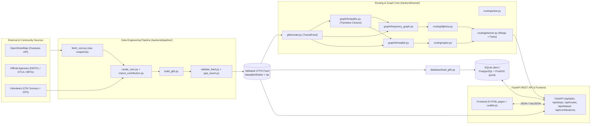
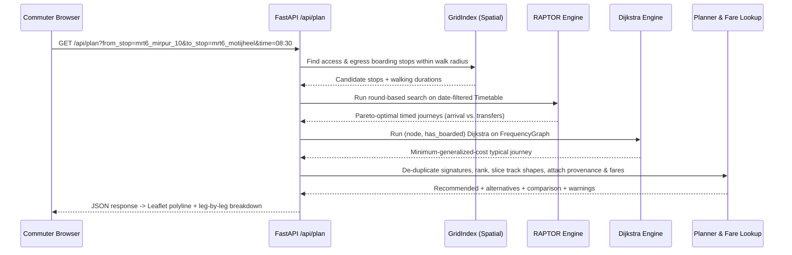
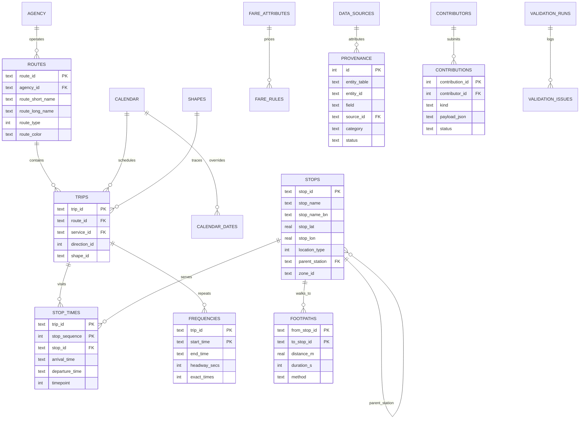

# System Architecture & Database Design

This document provides the high-level software architecture, request lifecycle, and
entity-relationship diagram for **Dhaka Transit**.

---

## 1. System Architecture

The codebase enforces a strict one-way dependency boundary:

- `backend/transit/` is **framework-independent** (Python standard library only — zero web, database, or pipeline imports).
- `backend/pipeline/` orchestrates Overpass snapshots, curation, community survey imports, GTFS builds, validation, and benchmarking.
- `backend/app/` is a thin FastAPI REST & static-file layer wrapping `transit/` and SQLite/PostGIS.
- `frontend/` is a zero-build HTML5/CSS3/ES-Module + Leaflet client served directly by FastAPI (or hostable standalone).

---

## 2. Multimodal Query Sequence (`/api/plan`)

---

## 3. Database Entity-Relationship Diagram

Both `database/schema_sqlite.sql` and `database/schema_postgis.sql` share an identical
two-layer relational model: **GTFS Core** (lossless 1:1 feed mapping) + **Project Extensions**
(provenance, data sources, derived footpaths, community submissions, and validation runs).

In PostgreSQL/PostGIS (`database/schema_postgis.sql`), `stops` adds a stored generated
`geography(Point, 4326)` column with a GiST spatial index for `O(log N)` KNN nearest-stop
queries (`ORDER BY geom <-> ST_MakePoint(lon, lat)`), and `shape_lines` provides a
materialized `LineString` geography view per route shape.
