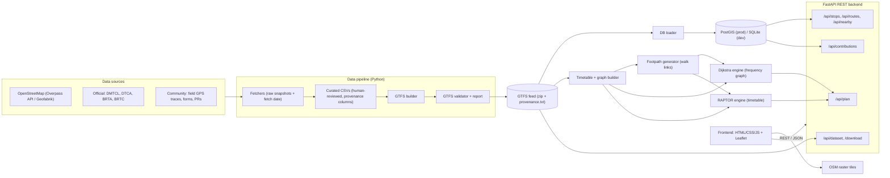
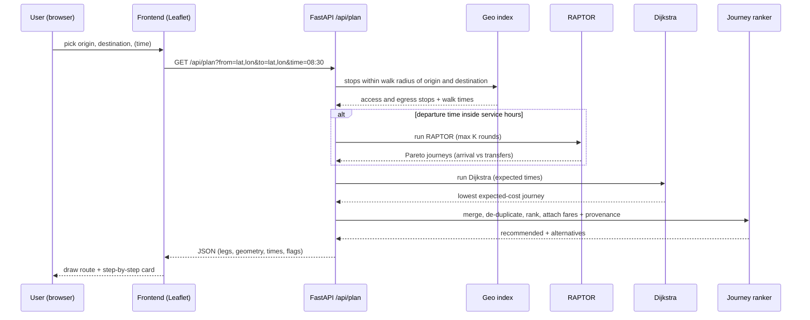
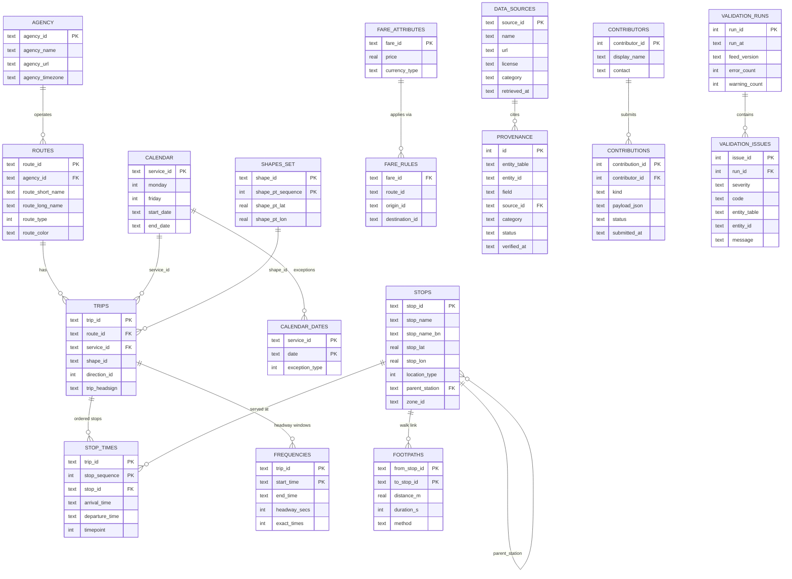

# Dhaka Transit — Project Plan (Phase 1 Planning Documents)

> Open Public Transport Dataset & Smart Multimodal Route Planner for Dhaka, Bangladesh.

> [!IMPORTANT]
> **Data-honesty rule used everywhere in this project:** every stop, route, schedule, fare and geometry has a **provenance tag** (`official`, `osm`, `community`, `estimated`). Anything without a source does not go in the feed. The UI shows the tag next to every value, so a guessed number can never look like a verified one. The planning text below contains **no** made-up travel times or fares. Facts quoted from the web are marked *to verify against the official source* until we have checked them.

---

## 1. System Architecture



### Component responsibilities

| Component | Folder | Responsibility | Depends on |
|---|---|---|---|
| **Data pipeline** | `backend/pipeline/` | Fetch OSM and official data, merge into curated CSVs, build GTFS, run validation | `transit.gtfs`, `transit.geo` |
| **GTFS module** | `backend/transit/gtfs/` | GTFS field spec, reader, writer, validator (framework-independent) | stdlib only |
| **Geo module** | `backend/transit/geo.py` | Haversine distance, walking time, grid spatial index for nearest-stop search | stdlib only |
| **Graph builder** | `backend/transit/graph/` | Build the frequency-based graph (for Dijkstra) and the RAPTOR timetable structures from the GTFS | GTFS module |
| **Dijkstra engine** | `backend/transit/routing/dijkstra.py` | Expected-time shortest path; also computes walking footpaths | graph |
| **RAPTOR engine** | `backend/transit/routing/raptor.py` | Schedule-based earliest arrival, Pareto set over number of transfers | timetable |
| **Journey ranking** | `backend/transit/routing/journey.py` | Common journey model, generalized cost, de-duplication, fare lookup | both engines |
| **Backend API** | `backend/app/` | FastAPI app, Pydantic schemas, auto-generated OpenAPI docs | transit core, DB |
| **Database** | `database/` | DDL for SQLite and PostGIS, loader script | — |
| **Frontend** | `frontend/` | 5 pages, Leaflet map module, API client | REST API |

**Key design choice:** the routing core (`transit/`) is plain Python with **no web or database imports**. You can unit-test it, run it from the command line, or later move it into a separate service. FastAPI is a thin layer on top.

### Route-query sequence



---

## 2. Technology Stack with Justification

| Layer | Choice | Why |
|---|---|---|
| Frontend | **HTML5 + CSS3 + vanilla JS (ES modules)** | Matches your spec. No build step, so anyone can contribute. Fast on low-end phones. |
| Map | **Leaflet 1.9** + OSM tiles | Light (~40 KB) and well documented. Supports GeoJSON layers for routes and stops. |
| Backend | **FastAPI** (recommended over Flask) | Generates OpenAPI/Swagger docs automatically (deliverable #6). Pydantic validates requests and responses. Supports async. Type hints make the code easier to review. |
| Server | Uvicorn | Standard ASGI server for FastAPI. |
| Database | **SQLite now → PostGIS for deployment** | PostgreSQL isn't installed on this machine. SQLite needs no setup, which makes Phases 2–4 faster. The schema is designed for both. PostGIS adds `geography` columns, GiST indexes and KNN (`<->`) nearest-stop queries. |
| Routing | **Own Python implementations** of Dijkstra, RAPTOR, A* | Writing the algorithms yourself is the academic contribution. The feed stays GTFS-compliant, so we can **cross-check results against OpenTripPlanner** later. |
| Data | GTFS (Schedule) + `frequencies.txt` + Fares v1 | `frequencies.txt` is the correct GTFS way to describe headway-based buses that don't follow a timetable. Dhaka buses work this way. |
| Validation | Own validator + **MobilityData GTFS Validator** (official, Java CLI) | Ours checks Dhaka-specific rules (stops inside the Dhaka bounding box, provenance coverage). The official validator proves spec compliance. |
| Testing | pytest + httpx (FastAPI TestClient) | Both already installed. |
| CI | GitHub Actions | Runs tests and the feed validator on every pull request, which is needed for community contributions. |
| Hosting | Frontend: GitHub Pages / Netlify. API: Render / Railway / Fly.io. DB: Neon or Supabase (both include PostGIS) | All have free tiers and use open-source-friendly tooling. |

> [!WARNING]
> **Licensing:** data derived from OpenStreetMap must be published under **ODbL** with "© OpenStreetMap contributors" attribution. Plan: code under **MIT**, dataset under **ODbL 1.0**. Production traffic must not use `tile.openstreetmap.org` heavily ([tile usage policy](https://operations.osmfoundation.org/policies/tiles/)). For the deployed site we'll switch to a tile provider with a free tier.

---

## 3. Database Design & ER Diagram

The schema has two layers:
1. **GTFS core tables.** These mirror the GTFS files exactly, so loading and exporting the feed is lossless.
2. **Project extension tables.** These hold provenance, sources, contributions, validation runs and derived walking footpaths.



**Provenance model.** `PROVENANCE` stores one row per record, or per field when the fields came from different sources. For example, a stop's coordinates might come from OSM while its name was field-verified by a volunteer.
- `category` ∈ `official | osm | community | estimated`
- `status` ∈ `verified | unverified | disputed`

In the published feed this becomes an extension file, `provenance.txt`. GTFS consumers ignore files they don't recognise, so the feed stays spec-compliant.

**PostGIS additions:** `stops.geom geography(Point,4326)` and `shapes` line geometry, each with a GiST index. Nearest-stop search becomes `ORDER BY geom <-> ST_MakePoint(lon,lat) LIMIT k`. In SQLite we store lat/lon and use the in-memory grid index from `transit.geo`.

---

## 4. Project Folder Structure

```text
Route Planner/                       ← repository root
├── README.md
├── LICENSE                          ← MIT (code)
├── DATA_LICENSE.md                  ← ODbL 1.0 (dataset)
├── CONTRIBUTING.md
├── .gitignore
├── pytest.ini
├── backend/
│   ├── requirements.txt
│   ├── app/                         ← FastAPI layer (Phase 3)
│   │   ├── main.py
│   │   ├── config.py
│   │   ├── api/  (plan.py, stops.py, routes.py, dataset.py, contributions.py)
│   │   ├── schemas/                 ← Pydantic request/response models
│   │   └── services/                ← planner service, feed cache
│   ├── transit/                     ← framework-independent core
│   │   ├── geo.py                   ← haversine, walk time, grid index
│   │   ├── provenance.py            ← provenance categories/status
│   │   ├── gtfs/  (spec.py, reader.py, writer.py, validator.py, model.py)
│   │   ├── graph/ (frequency_graph.py, timetable.py, footpaths.py)
│   │   └── routing/ (dijkstra.py, raptor.py, astar.py, journey.py, fares.py)
│   ├── pipeline/                    ← data collection & GTFS build (Phase 2)
│   │   ├── fetch_osm.py             ← Overpass queries (stops, routes, MRT-6)
│   │   ├── build_gtfs.py
│   │   └── validate_feed.py
│   └── tests/
├── data/
│   ├── raw/                         ← untouched source snapshots (dated)
│   ├── curated/                     ← human-reviewed CSVs = source of truth
│   ├── gtfs/dhaka/                  ← built GTFS feed (+ dhaka_gtfs.zip)
│   └── reports/                     ← validation & evaluation reports
├── database/
│   ├── schema_sqlite.sql
│   ├── schema_postgis.sql
│   └── load_gtfs.py
├── frontend/
│   ├── index.html  map.html  results.html  dataset.html  about.html
│   ├── css/styles.css
│   └── js/ (api.js, map.js, search.js, results.js, dataset.js)
├── contributions/templates/         ← CSV templates for volunteers
├── docs/                            ← architecture, methodology, API, algorithms, evaluation
└── .github/workflows/ci.yml
```

---

## 5. Development Roadmap (12 weeks + 2 buffer = 14)

| Week | Phase | Deliverables | Exit test (must pass before moving on) |
|---|---|---|---|
| 1 | **1 — Research & planning** | This plan, repo scaffold, SQL schemas, GTFS field spec, geo utils | `pytest` passes; schema builds in SQLite |
| 2 | **2 — Data: Metro Line 6** | Stations from OSM and checked against DMTCL; line geometry; fare matrix and headways from DMTCL (official) | 16 stations, all inside Dhaka bbox, in correct order, all with provenance |
| 3 | **2 — Data: buses (OSM)** | Overpass extract of `route=bus` relations and `highway=bus_stop`; gap report | Validator shows 0 errors; every route has ≥2 stops and a shape |
| 4 | **2 — Data: field pilot** | 5–10 high-demand corridors (e.g., Mirpur ↔ Motijheel) surveyed with GPS; contribution templates | Surveyed stops within 30 m of the GPS trace; duplicate-stop check passes |
| 5 | **3 — Backend: DB & GTFS processing** | SQLite loader, GTFS reader/writer round-trip, PostGIS DDL tested | Load → export produces an identical feed |
| 6 | **3 — Backend: graph & API** | Frequency graph, timetable, footpaths; `/stops`, `/routes`, `/nearby` endpoints | API tests pass; Swagger docs at `/docs` |
| 7 | **4 — Dijkstra** | Dijkstra on the frequency graph with transfer penalties | Matches brute-force results on toy graphs; connectivity tests |
| 8 | **4 — RAPTOR + integration** | RAPTOR with footpaths, journey reconstruction, Pareto set; `/plan` | Agrees with a time-expanded Dijkstra on toy feeds; real-feed smoke tests |
| 9 | **5 — Frontend: map** | Home and map pages, layers and filters, stop popups | Manual check on desktop and mobile; Lighthouse accessibility score ≥ 90 |
| 10 | **5 — Frontend: results & dataset** | Results page, journey cards, dataset page, about page | End-to-end Mirpur 10 → Motijheel search renders |
| 11 | **6 — Integration & evaluation** | Benchmark OD set, Dijkstra vs RAPTOR comparison, field-timed trips | Evaluation report generated from real feed |
| 12 | **7 — Deployment & docs** | Deployed app, published feed (zip), README, API docs, slides | Public URL works; MobilityData validator report attached |
| 13–14 | Buffer | Community data drive, OSM contributions, polish, presentation | — |

---

## 6. Required Datasets & Potential Sources

| # | Dataset | Source | Category | Notes / licence |
|---|---|---|---|---|
| 1 | MRT Line 6 station list, order, fares, operating hours, headways | **DMTCL** official site (dmtcl.gov.bd) and its published fare chart | official | Web summaries currently report 16 operational stations, Uttara North → Motijheel, fare ৳20 min / ৳100 max, Kamalapur extension pending. *To verify against the official source before use.* |
| 2 | MRT Line 6 station coordinates and track geometry | **OpenStreetMap** (`railway=station`, `route=subway/light_rail` relation) | osm | ODbL; checked against satellite imagery and the DMTCL station list |
| 3 | Bus stops | OSM `highway=bus_stop`, `public_transport=platform` | osm | Coverage in Dhaka is partial; gaps go into the gap report |
| 4 | Bus routes and stop sequences | OSM `type=route` + `route=bus` relations (PTv2) | osm | Many lines are incomplete or unordered; validator flags these |
| 5 | Route rationalisation / franchise bus routes (e.g., "Dhaka Nagar Paribahan") | **DTCA** (Dhaka Transport Coordination Authority) | official | Route lists from DTCA publications |
| 6 | Government bus routes | **BRTC** | official | Routes and depots |
| 7 | Bus fare rate (per-km rate, minimum fare) | **BRTA** fare gazette / notices | official | Bus fares are only computed when a current gazette rate is on file; otherwise shown as "fare unknown" |
| 8 | Community bus directories | e.g., GitHub `imamhossain94/dhaka-city-local-bus-json-data`, Mendeley "Shortest Route Analysis of Dhaka City Roads" | community | **Check each licence first.** Use only to cross-reference until permission or licence allows reuse |
| 9 | Field survey (stops, sequences, observed travel times, headways) | Volunteers using OsmAnd / GPSLogger + a CSV/KoboToolbox form | community | Raw GPX stored in `data/raw/`. Measured times feed the evaluation |
| 10 | Existing GTFS feeds | Transitland, Mobility Database | depends | Check for any existing Dhaka feed to avoid duplicate work |
| 11 | Background demand & corridors | JICA RSTP / DHUTS reports, academic papers | official/academic | Used to choose priority corridors, not as feed data |
| 12 | Geocoding (place-name search) | **Nominatim** (OSM) limited to a Dhaka viewbox, plus local stop-name search | osm | Respect the Nominatim usage policy (≤1 req/s, cache results) |

> [!CAUTION]
> Do **not** copy data from Google Maps or scrape third-party commercial apps. Their terms of service forbid it, and it would make the dataset legally unpublishable. A person may look at them for cross-checking, but nothing gets copied into the feed.

### How bus schedules will be modelled honestly
Dhaka buses do not run to published timetables. We model them like this:
- **`frequencies.txt`** with `exact_times=0`, which is the GTFS way of saying "every ~N minutes".
- **`stop_times.txt`** with `timepoint=0`, which is the GTFS flag for *approximate* times.
- Segment run times come from field-measured trips where available. Otherwise they are estimated from distance and a documented assumed speed, and tagged `estimated`.
- The UI labels any journey that contains an estimated value as **"Estimated"**.

---

## 7. How Dijkstra and RAPTOR Work Together

They answer two different questions, so we use both:

| | **Dijkstra** (frequency-based graph) | **RAPTOR** (timetable) |
|---|---|---|
| Question | "What is the typical best route, ignoring the clock?" | "If I leave at 08:30, what is the earliest I can arrive, for each possible number of transfers?" |
| Needs a departure time? | No | Yes |
| Data used | Average in-vehicle times, expected wait = headway ÷ 2 | Concrete trips (frequency windows expanded into trips) |
| Output | One minimum-generalized-cost path | Pareto set: {fastest with 0 transfers, fastest with 1, …} |
| Role in system | Fallback when no time is given or outside service hours; footpath precomputation; baseline for comparison | Main planner when a time is given; source of alternative routes |

### 7.1 Dijkstra — graph structure
- **Nodes**
  - `S(p)`: physical stop or station *p*.
  - `R(r,d,p)`: "on route *r*, direction *d*, at stop *p*". Route-stop nodes let staying on the same bus cost nothing, while getting off and boarding another bus costs a wait.
  - Virtual `ORIGIN` and `DEST` nodes for the user's coordinates.
- **Edges (weight = seconds, always ≥ 0)**
  - `ORIGIN → S(p)`: access walk = distance × detour factor ÷ walking speed.
  - `S(p) → R(r,d,p)` *board*: expected wait (headway ÷ 2) + transfer penalty.
  - `R(r,d,p_i) → R(r,d,p_{i+1})` *ride*: in-vehicle time from `stop_times`.
  - `R(r,d,p) → S(p)` *alight*: 0.
  - `S(p) → S(q)` *walk transfer*: walking time if within the transfer radius (e.g., metro station ↔ nearby bus stop).
  - `S(p) → DEST`: egress walk.
- **Generalized cost**: in-vehicle time + α·wait + β·walk + γ·(transfers). α, β, γ live in `config.py`; defaults are documented as assumptions. The penalty is added on every boarding and the first one is subtracted, so the first boarding is free.
- **Algorithm**: binary-heap Dijkstra, `O((V+E) log V)`. We stop as soon as `DEST` is settled. Predecessor pointers are used to rebuild legs.

### 7.2 RAPTOR — round-based timetable routing
- **Data structures** (built once from GTFS):
  - *Routes* = groups of trips that share the exact same stop sequence.
  - For each route, trips are sorted by departure.
  - Lookups for "routes serving stop *p*" and the footpath list.
- **Labels**: `τ_k(p)` is the earliest arrival at stop *p* using at most *k* trips. `τ*(p)` is the best arrival over all rounds (used for pruning).
- **Round 0**: for every access stop *p*, `τ_0(p)` = departure time + access walk.
- **Round k**:
  1. Collect the routes that serve stops *marked* (improved) in round k−1.
  2. **Route scan**: walk along each route from its earliest marked stop, carrying the *earliest catchable trip*. At each stop, the arrival time may improve `τ_k`, but only if it beats both `τ*(p)` and the current best arrival at the destination (target pruning). If an earlier trip can be caught at this stop, switch to it.
  3. **Transfers**: relax footpaths from every newly improved stop.
  4. Stop when no stop is marked or *k* reaches K_max (e.g., 5).
- **Journey reconstruction**: each improved label stores a back-pointer (`trip`, `boarding stop`, `alighting stop`) or (`footpath`). We trace back from the best egress stop in each round.
- **Pareto set**: round *k* gives the fastest journey with *k*−1 transfers. A round's journey is kept only if it arrives earlier than all journeys with fewer transfers. These become the **alternatives**.
- Complexity per query: `O(K · (Σ_r |stops(r)| + |trips scanned| + |footpaths|))`. There is no priority queue, so it is fast on large networks.

### 7.3 Combined query pipeline
1. **Access/egress**: grid index → stops within ~800 m (configurable) → walk times. Version 1 uses haversine × detour factor. The optional version 2 uses **A\*** on the OSM pedestrian network.
2. **Footpaths**: precomputed offline with a bounded Dijkstra from each stop over walk links, then made transitively closed, which RAPTOR requires.
3. If a departure time is given and service is running → **RAPTOR** gives the Pareto journeys.
4. **Dijkstra** always runs → gives the "typical" journey. It is the only answer when there is no time or service has ended (labelled "outside service hours").
5. **Merge**: journeys that use the same sequence of (route, board, alight) are de-duplicated and ranked by generalized cost. Fares are attached only from verified fare data (MRT fare matrix, bus gazette rate). Each leg carries its provenance flags.
6. **Evaluation** (Phase 6): compare the engines on the same OD set for query time, travel time, transfers, and agreement rate, and check both against field-timed trips.

---

## 8. Key Decisions (defaults I'm using unless you say otherwise)
1. **FastAPI** rather than Flask.
2. **SQLite for development**, with PostGIS DDL kept in sync for deployment.
3. **Code MIT, dataset ODbL.**
4. **First bus scope**: corridors that connect to MRT-6 (Mirpur, Farmgate, Shahbagh, Motijheel) before expanding citywide.
5. Phase 2 needs **network access** (Overpass API) to fetch real OSM data. I'll ask for approval when we get there.
